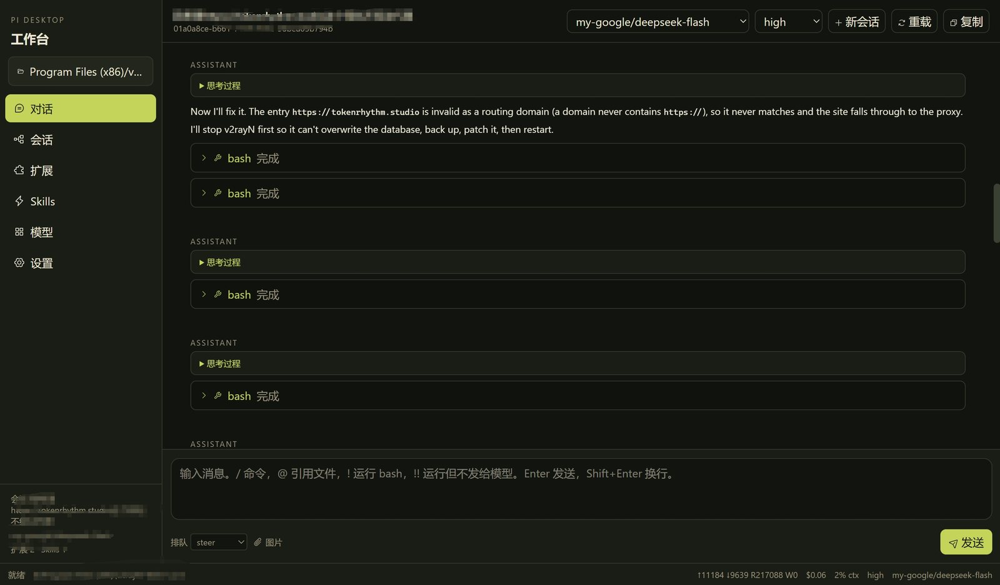
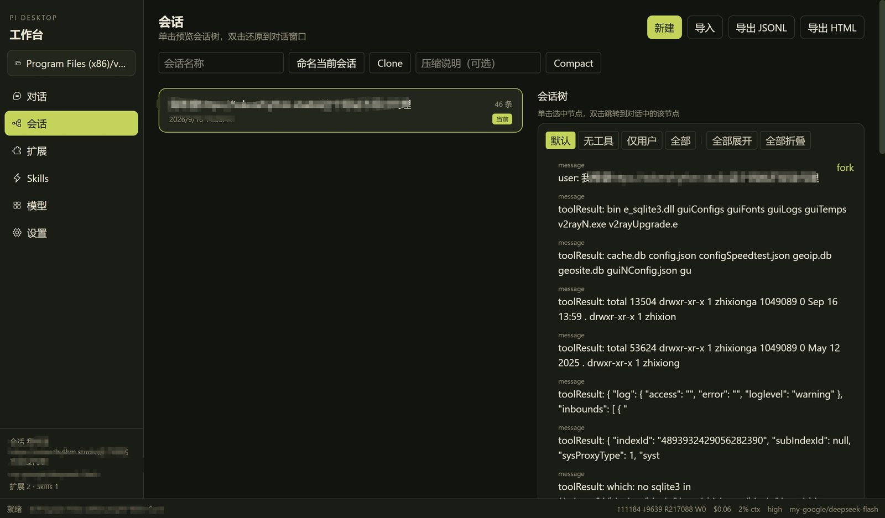
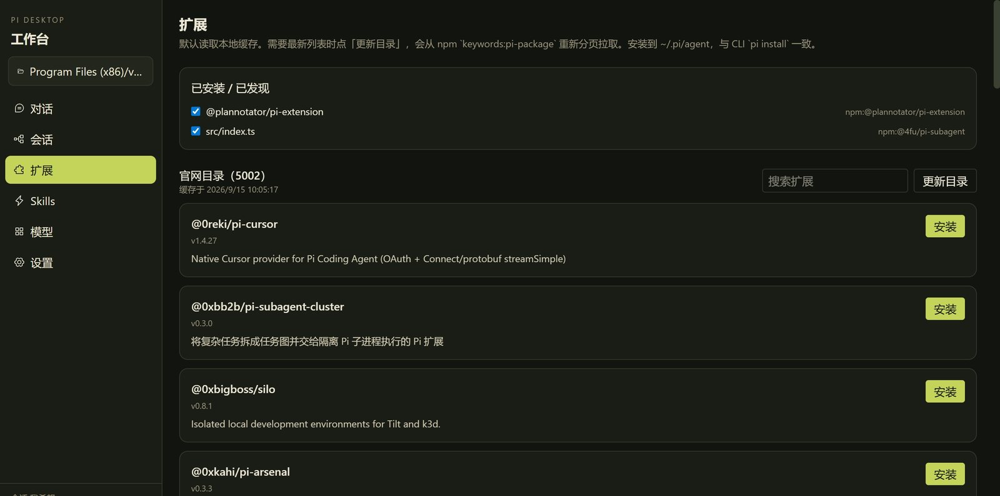
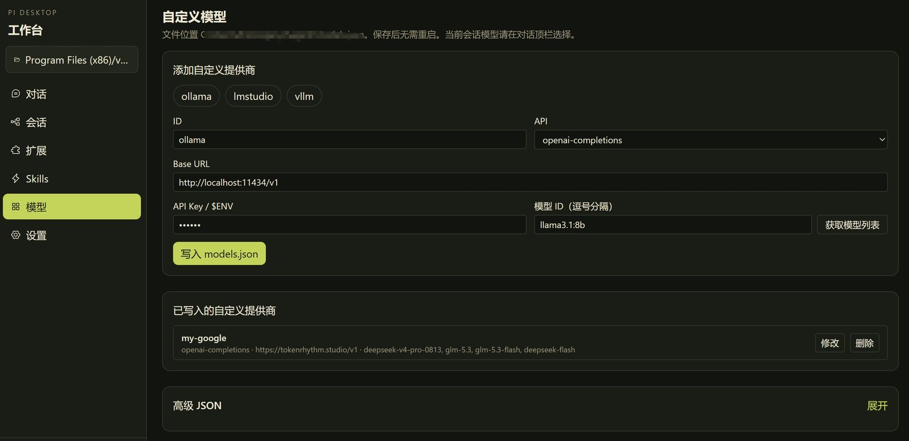
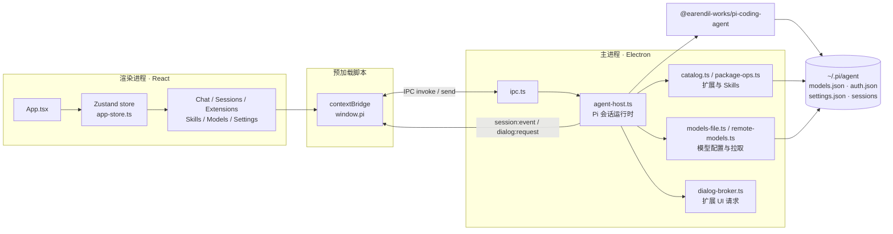

<div align="center">

# Pi Desktop

**Pi 编码助手的独立桌面客户端 · Electron + React**

图形化使用 Pi 编码助手：对话、工具调用、会话树、扩展与 Skills、自定义模型，
全部通过官方 npm 包 [`@earendil-works/pi-coding-agent`](https://www.npmjs.com/package/@earendil-works/pi-coding-agent) 运行，
配置与会话默认与命令行 `pi` 共享 `~/.pi/agent`。

[](https://www.electronjs.org/)
[](https://react.dev/)
[](https://www.typescriptlang.org/)
[](https://electron-vite.org/)
[](https://tailwindcss.com/)
[](https://nodejs.org/)

[功能特性](#-功能特性) · [界面截图](#-界面截图) · [快速开始](#-快速开始) · [打包发布](#-打包发布) · [项目结构](#-项目结构) · [使用文档](USAGE.md)

</div>

---

## 简介

Pi Desktop 是一个完全独立的桌面应用，源码不依赖任何 `pi-main` 源码树，只通过官方 SDK 与 Pi 运行时交互。
它把 Pi 编码助手的能力搬到图形界面：流式对话、工具调用可视化、会话分支树、扩展 / Skills 管理、多提供商模型配置等。

- **数据复用**：配置、认证、会话均读写 CLI 共用的 `~/.pi/agent`，桌面端与命令行无缝切换。
- **流式交互**：消息、思考过程、工具调用、bash 执行实时增量渲染，可随时中止或追加（steer / follow-up）。
- **图形化配置**：无需手动编辑 JSON，即可管理 `models.json`、扩展、Skills、项目信任与常用设置。

## ✨ 功能特性

| 模块 | 能力 |
| --- | --- |
| 💬 对话 | 流式输出、Markdown（GFM）渲染、可折叠思考过程、工具调用卡片、bash 执行结果、图片多模态输入 |
| 🧭 会话 | 会话列表、新建 / 恢复 / 命名 / 删除、Clone、手动压缩、会话树导航与 fork、`jsonl` / `html` 导入导出 |
| 🧩 扩展 | 浏览 npm 目录（`keywords:pi-package`）、安装 / 卸载、一键启停、更新目录缓存 |
| ⚡ Skills | 与扩展一致的目录管理，额外支持导入 `SKILL.md` 或本地技能目录 |
| 🎛️ 模型 | 图形化编辑 `models.json`，支持 OpenAI / Anthropic / Google 兼容接口，可拉取远端模型列表勾选 |
| 🔌 MCP | 接入 Model Context Protocol 服务器（stdio / HTTP），自动发现并注册工具、连接状态与错误展示、测试连接、工具级开关、stdio 命令授权确认 |
| ⚙️ 设置 | 深色 / 浅色 / 跟随系统主题、默认思考等级、隐藏思考块、自动压缩 / 重试、项目信任策略（除主题外与 CLI 共用 `settings.json`） |
| 🔐 提供商 | 通过 IPC 触发 API Key / OAuth 登录流程，扩展 UI 请求（confirm / input / secret / select）映射为原生对话框 |
| 📊 状态 | 底部状态栏实时展示运行状态、工作目录、Token 用量、花费、上下文占比、思考等级与当前模型 |

## 🖼️ 界面截图

### 对话页 — 流式对话、思考过程与工具调用



### 会话页 — 会话列表、分支树、Clone 与压缩



### 扩展页 — 浏览、安装与启停 Pi 扩展



### 模型页 — 图形化编辑自定义提供商



## 🧱 技术栈

| 层次 | 技术 |
| --- | --- |
| 运行时 | [Electron](https://www.electronjs.org/) `37.3.1` · Node.js `≥ 22.19.0` |
| 界面 | [React](https://react.dev/) `19.1.1` · [Tailwind CSS](https://tailwindcss.com/) `4.1.13` · [Phosphor Icons](https://phosphoricons.com/) `2.1.10` |
| 状态 | [Zustand](https://zustand-demo.pmnd.rs/) `5.0.8` |
| 渲染 | [react-markdown](https://github.com/remarkjs/react-markdown) `10.1.0` · [remark-gfm](https://github.com/remarkjs/remark-gfm) `4.0.1` |
| 构建 | [electron-vite](https://electron-vite.org/) `4.0.0` · [Vite](https://vitejs.dev/) `7.1.5` · TypeScript `5.9.2` |
| 打包 | [electron-builder](https://www.electron.build/) `26.0.12`（Windows NSIS/zip & macOS dmg/zip） |
| Pi 运行时 | [`@earendil-works/pi-coding-agent`](https://www.npmjs.com/package/@earendil-works/pi-coding-agent) `^0.84.2` |

## 🏗️ 架构



- **主进程**：承载 Pi 会话运行时（`AgentHost`），负责模型、会话、扩展、Skills、登录与文件系统操作。
- **预加载脚本**：通过 `contextBridge` 暴露类型安全的 `window.pi` API（`contextIsolation: true`，禁用 `nodeIntegration`）。
- **渲染进程**：纯 React，UI 状态集中在 Zustand store；主进程通过 `session:event` 推送流式事件，`dialog:request` 发起原生对话框。

## 📋 环境要求

- Windows / macOS / Linux
- Node.js `>= 22.19.0`
- 无需本地存在 `pi-main` 源码

## 🚀 快速开始

```bash
# 1. 克隆仓库
git clone https://github.com/andy8609/pi-harness-desktop.git
cd pi-harness-desktop

# 2. 安装依赖（--ignore-scripts 与官方 CLI 一致，避免依赖生命周期脚本）
npm install --ignore-scripts

# 3. 单独下载 Electron 二进制（--ignore-scripts 会跳过它）
#    国内网络可先设置镜像：
#    Windows:  $env:ELECTRON_MIRROR='https://npmmirror.com/mirrors/electron/'
#    macOS/Linux: export ELECTRON_MIRROR='https://npmmirror.com/mirrors/electron/'
node node_modules/electron/install.js

# 4. 启动开发环境
npm run dev
```

启动后：

1. 点击左侧 **「打开项目目录」**，选择一个代码目录。
2. 在 **对话页** 顶栏选择模型（若为空，先到 **模型页** 添加自定义提供商）。
3. 在输入框输入消息，按 **Enter** 发送。

> 常用快捷键：`Enter` 发送、`Shift+Enter` 换行、`Alt+Enter` 追加发送、`Esc` 中止、`Ctrl/Cmd+V` 粘贴图片。

## 📦 打包发布

### 一键脚本（推荐）

| 平台 | 操作 | 产物 |
| --- | --- | --- |
| Windows | 双击 `scripts/pack-win.bat` | `release/Pi Desktop-*-win-x64.exe`（NSIS 安装包）+ `.zip` |
| macOS | 双击 `scripts/pack-mac.command` | `release/Pi Desktop-*-mac-{x64,arm64}.dmg` + `.zip` |

> macOS 上若双击被拦截，先执行 `chmod +x scripts/pack-mac.command`，或在「系统设置 → 隐私与安全性」中允许打开。

### npm 命令

```bash
npm run pack           # 等同 pack:win
npm run pack:win       # Windows: NSIS 安装包 + zip
npm run pack:win:sign  # Windows: 完整资源编辑/签名（需开发者模式或管理员）
npm run pack:mac       # macOS: dmg + zip（x64 + arm64）
npm run pack:mac:x64   # macOS 仅 Intel
npm run pack:mac:arm64 # macOS 仅 Apple Silicon
npm run pack:all       # Windows + macOS（需在 macOS 上执行）
npm run pack:dir       # 只生成免安装目录，便于本地调试
```

产物在 `release/`。每次执行打包脚本都会先把 `package.json` 的补丁版本号 +1，再用于安装包文件名与应用内显示（设置页标题、侧栏底部）。
需要手动递增时执行 `npm run version:bump`。

### 注意事项

- **网络**：Electron / electron-builder 二进制默认从 GitHub 下载，国内可能超时。
  一键脚本已自动设置 npmmirror 镜像（可用环境变量覆盖）：

  ```bash
  export ELECTRON_MIRROR=https://npmmirror.com/mirrors/electron/
  export ELECTRON_BUILDER_BINARIES_MIRROR=https://npmmirror.com/mirrors/electron-builder-binaries/
  ```

- **Windows 符号链接权限**：electron-builder 解压 `winCodeSign` 时需要创建 macOS 符号链接，普通账号会报
  `Cannot create symbolic link`。因此 `electron-builder.yml` 默认设置 `win.signAndEditExecutable: false`
  （跳过 exe 图标 / 版本信息 / 签名）。若需写入图标或代码签名，请开启「开发人员模式」或以管理员运行，再执行 `npm run pack:win:sign`。
- **macOS 的 dmg 只能在 macOS 上构建**；`pack:all` 请在 Mac 上运行。
- 未配置证书时 `mac.identity: null` 会产出**未签名**应用；正式分发请配置 Apple 证书与公证。
- **应用图标**：将 `build/icon.ico`（Windows）、`build/icon.icns`（macOS）放入项目 `build/` 目录即可自动使用，未提供时使用 Electron 默认图标。

## 🗂️ 项目结构

```
pi-harness-desktop/
├─ src/
│  ├─ main/                    # Electron 主进程
│  │  ├─ index.ts              # 应用入口、窗口与生命周期
│  │  ├─ agent-host.ts         # Pi 会话运行时封装（对话 / 会话 / 模型 / 登录）
│  │  ├─ ipc.ts                # IPC 通道注册
│  │  ├─ catalog.ts            # 扩展 / Skills 目录（npm keywords:pi-package）
│  │  ├─ package-ops.ts        # 扩展安装 / 卸载 / 启停
│  │  ├─ models-file.ts        # models.json 读写
│  │  ├─ remote-models.ts      # 拉取远端模型列表
│  │  ├─ mcp/                  # MCP 客户端：配置 / 连接 / 工具注册 / IPC
│  │  ├─ extensions/           # 内置 pi 扩展（权限 / GPA / MCP 工具注入）
│  │  ├─ dialog-broker.ts      # 扩展 UI 请求 → 原生对话框
│  │  ├─ file-search.ts        # @ 文件引用搜索
│  │  ├─ prefs.ts              # 窗口尺寸 / 上次项目等桌面偏好
│  │  └─ serialize.ts          # 会话与消息序列化
│  ├─ preload/                 # contextBridge 桥接（window.pi）
│  ├─ renderer/                # React 渲染进程
│  │  ├─ index.html
│  │  └─ src/
│  │     ├─ App.tsx
│  │     ├─ components/        # Chat / Sessions / Extensions / Skills / Models / Settings ...
│  │     ├─ stores/app-store.ts
│  │     ├─ lib/               # 文本与远端模型工具
│  │     └─ styles/global.css
│  └─ shared/                  # 主 / 渲染共享类型定义
├─ scripts/                    # 跨平台打包脚本
├─ docs/screenshots/           # README 截图
├─ electron.vite.config.ts     # electron-vite 配置
├─ electron-builder.yml        # 打包配置
└─ package.json
```

## 💾 数据与文件位置

| 内容 | 位置 |
| --- | --- |
| 模型配置 | `~/.pi/agent/models.json` |
| 认证信息 | `~/.pi/agent/auth.json` |
| 通用设置 | `~/.pi/agent/settings.json` |
| 会话记录 / 扩展 / Skill | `~/.pi/agent`（按项目组织，与 CLI 共用） |
| 桌面窗口尺寸、上次项目 | Electron `userData` 目录（不写入项目源码） |
| MCP 服务器配置 | `~/.pi/agent/mcp-servers.json`（与 pi CLI 配置同目录，可用 `PI_MCP_CONFIG_PATH` 覆盖） |

## 📚 文档

- **[USAGE.md](USAGE.md)** — 完整使用手册：界面总览、输入框、斜杠命令、会话树、扩展 / Skills / 模型 / 设置、快捷键与常见问题。
- **[docs/mcp/README.md](docs/mcp/README.md)** — MCP 使用与配置：字段说明、示例、安全策略、故障排查、开发者接入点。

## ❓ 常见问题

<details>
<summary>点击任何按钮都提示「请先打开一个项目目录」？</summary>

先点击左侧「打开项目目录」选择一个目录。
</details>

<details>
<summary>模型列表为空 / 无法选择模型？</summary>

到 **模型页** 添加自定义提供商并保存，或先用 CLI 配置好 `~/.pi/agent/models.json` 与认证。
</details>

<details>
<summary>想登录官方提供商（API Key / OAuth）怎么办？</summary>

桌面端可触发登录流程，也可直接使用 CLI `pi login`；或在「模型页」使用自定义提供商。输入 `/login` 会给出提示。
</details>

<details>
<summary>改了扩展 / Skill 但对话里没生效？</summary>

点击对话页顶栏的 **重载**，或在扩展 / Skills 页启停后会自动重载资源。
</details>

<details>
<summary>扩展弹不出界面？</summary>

TUI 专用的 `ctx.ui.custom()` 组件无法在桌面端渲染，会降级为 Toast 提示；`select` / `confirm` / `input` / `notify` 均已映射为桌面对话框 / 通知，这是预期行为。
</details>

<details>
<summary>多个会话如何切换？</summary>

到 **会话页** 单击预览、双击还原；或在输入框输入 `/resume`。
</details>

---

<div align="center">

桌面端只是提供图形化操作入口，所有配置与会话均与命令行版 Pi 共享。

</div>
